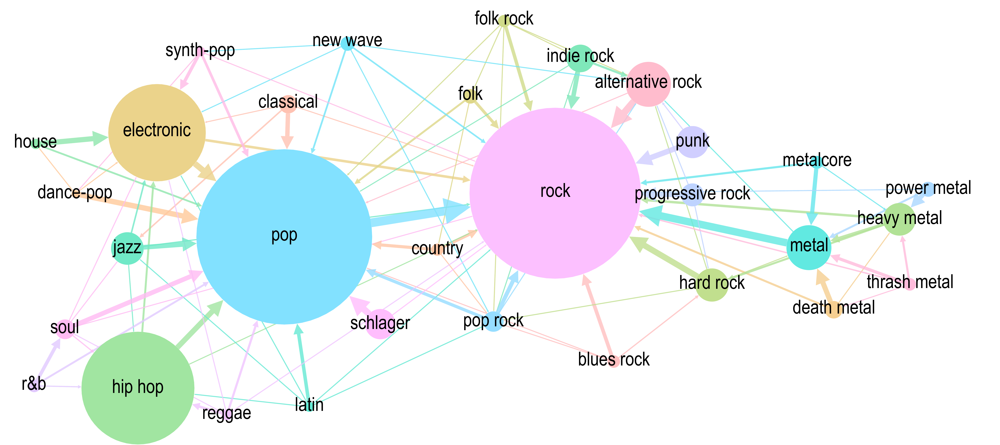

# <b>SHAMPOO</b>: <b>S</b>calable <b>H</b>ierarchical <b>A</b>ssignment of <b>M</b>usic Genres for <b>PO</b>pular music <b>O</b>bjects

<p align="center">
  
  <br/>
  
</p>

<!-- badges: start -->
<p align="center">
  
  
  
  
  
  
</p>
<!-- badges: end -->

## Paper

>[!NOTE]
> Paper details will be added upon publication.

### Abstract
Despite playlists’ popularity on streaming platforms, popular music genres remain a primary orientation scheme among listeners, industry, and researchers. Categorical genre assignments underpin foundational empirical musicological research, but ‘correct’ genre labels are often contested, raising concerns about reliability, validity, and comparability of research results. Contrarily, popular music studies have emphasized the listener-dependent and hierarchical nature of genre assignments – they may be considered as implicit majority voting results of a listener community. Adopting this notion, we present a methodology to assign genre categories based on folksonomy genre votes (SHAMPOO) and demonstrate its feasibility when used with MusicBrainz and 170,039 frequently listened tracks in Germany across the past 50 years (POPTRAG). The resulting hierarchical network for popular music in Germany comprises 434 genres that can be rescaled to any desired number of categories by exploiting latent hierarchical relationships in community tags. Subsequentially, we demonstrate reliability and validity of the procedure. Finally, for tracks lacking community votes, we develop machine learning classifiers at multiple granularity levels using freely-available music features and metadata from online databases. Exemplary results indicate our approach can assign an appropriate genre category to virtually any popular music track, representing listeners’ perspective in a transparent, reproducible, and intersubjectively comprehensible way. 

## Repository layout
This repository contains both, an R package containing the SHAMPOO algorithm functions and an analysis pipeline for an exemplary analysis of a corpus of popular music that was frequently listend to in Germany of the past 50 years (POPTRAG).

### R package
The `R` folder contains all functions from the R package. The folders `man` and `test` contain standard package documentation and package function tests. In the root folder, the following files belong to the R package: 
- `DESCRIPTION`
- `NAMESPACE`
- `.Rbuildignore`

### Exemplary Analysis of POPTRAG Corpus
Please find the analysis pipeline for reproduction in the `analysis` folder of the repository, organized by research question (RQ). RQ5 Scripts are placed in a subfolder called `analysis/RQ5`. Each script is standalone (there is no orchestrating script), reads the outputs of the previous steps, and can be run on a different machine:

| Script | Content |
|---|---|
| `00_prepare_corpora.R` | MusicBrainz, Discogs, Deezer, and Spotify tag corpora |
| `RQ1RQ2_German_popular_music_genres.R` | Study 1: granularities, supergenre networks, flows |
| `RQ3_robustness_varying_prevalences.R` | Study 2: robustness against varying genre prevalences |
| `RQ4_compare_dc_dz.R` | Study 2: comparison with Discogs and Deezer |
| `RQ5a_split_labels_spotify_genres.R` | Study 3: train/holdout split, labels, Spotify distribution genres |
| `RQ5b_lyrics_1_prepare_corpora.R` → `RQ5b_lyrics_2_fighting_vocabularies.py` → `RQ5b_lyrics_3_stm.py` → `RQ5b_lyrics_4_expression_features.R` | Study 3: lyrics expression type features |
| `RQ5c_prepare_ML_data.R` | Study 3: feature joining, dummy coding, CV folds |
| `RQ5d_ML_lightgbm.R` | Study 3: LightGBM tuning, training, evaluation, permutation feature importance |
| `RQ5e_ML_linear_svm.R` | Study 3: linear SVM grid search, training, evaluation |
| `RQ5f_ML_tabicl.R` | Study 3: TabICLv2 (requires a CUDA GPU) |
| `RQ5g_ML_summary.R` | Study 3: performance table of all models |


Further files:
- `analysis/config.R`: shared settings of all scripts (random seed, lambda for genre aggregation, chosen granularities, number of parallel workers, etc.), see [How to Run the Replication](#how-to-run-the-replication)
- `analysis/helpers/*`: helper functions related to the RQs
  - `analysis/helpers/RQ5/spotify_shampoo_genres.R` contains the functions to model additional Spotify SHAMPOO genres
  - `analysis/helpers/RQ5/lyrics_analysis/helpers` contains the functions to perform the MoreThanWords algorithm (Radke & Lepa, 2026), for further details see [this repository](https://github.com/markusradke/MoreThanWords)
>[!NOTE]
> The scripts reference additional folders. These will be created automatically by `00_prepare_corpora.R`.

`data-raw` contains data that is necessary for reproduction. Specifically, this repository includes: 
- `musicbrainz_genre_whitelist_20250616.rds`
  
  A snapshot of MusicBrainz' genre whitelist as of June 16, 2025.
- `classification_prep_features.rds`

  Information on the variables from the corpus used for machine learning (RQ5)
>[!IMPORTANT]
> For running the replication you need additional data, please refer to the [Data Availability Section](#data-availability) below.

>[!NOTE]
> A link to the paper describing the analysis will be added upon publication.

## Data Availability

The data necessary to reproduce the analysis are available in the DepositOnce repository, https://doi.org/10.14279/depositonce-26469. Respecting copyright restrictions, the publicly available version of the POPTRAG corpus does not contain the full lyrics for the songs included in the data set. However, all lyrics features required for reproduction of results are provided in the repository. Please contact us if you require further assistance. 

For analysis the files need to be placed in the following way: 
- `poptrag.rds` &rarr; `data-raw/poptrag.rds`
- `expressiontypes_train_no_ref_type.csv` &rarr; `data/modeled_features/lyrics/expressiontypes_train_no_ref_type.csv`
- `expressiontypes_holdout_no_ref_type.csv` &rarr; `data/modeled_features/lyrics/expressiontypes_holdout_no_ref_type.csv`

>[!NOTE]
> The folders for the `expressiontype` files are created by `00_prepare_corpora.R`. If you use the provided files, skip the `RQ5b_lyrics_*` scripts.

Further details on the POPTRAG corpus can be found in repository on DepositOnce.

## R Package Installation

Please use the following command in R to install the package: 
```
devtools::install_github("markusradke/shampoo")
```

Please refer to the function documentation for details on usage. The package has three
user-facing functions:

1. `create_genre_dag()`
2. `aggregate_genre_categories()`
3. `assign_genre_categories()`

For example:

```r
dag <- shampoo::create_genre_dag(tags)
categories <- shampoo::aggregate_genre_categories(dag, lambda = 0.5)
assignments <- shampoo::assign_genre_categories(
  tags,
  categories,
  k = 10,
  method = "both"
)

# Several granularities are prepared in one pass:
assignments_by_k <- shampoo::assign_genre_categories(
  tags,
  categories,
  k = c(5, 10, 20)
)
```

Assignments contain one row per track. The default `"both"` method returns fuzzy
category probabilities as well as the winning hard category and its probability.
Each result also includes `assignment_status`: `"assigned"` for tracks whose
tags were all recognized, `"partial_unknown_tags"` when some input tags were
unknown, and `"no_recognized_tags"` when none of a track's tags were recognized.
Track identifiers are provided only in the `id` column; row names are not used
as identifiers.
Use `method = "hard"` or `method = "fuzzy"` to request only one representation.
When multiple values are supplied for `k`, the result is a named list with one
assignment data frame per requested value. Values of `k` below the number of
terminal genres (genres without supergenres) are raised to that number. The DAG
and category objects retain the normalized tag matrix and canonical tag order
for reproducible reuse.

Instead of a number of categories, you can also aggregate to a fixed set of
genres with `aggregate_genre_categories(dag, target_set = c(...))`. All other
genres are folded into their supergenres; terminal genres missing from the set
are added with a warning.

If, during the assignment of genres using a SHAMPOO mapping, a track has equal probabilities for several categories, the hard category is the one whose tag occurs on the fewest tracks of the assigned data. This rule favors the
more specific genre in the new data.

Please make sure you start from long tabular data with columns: `id` (unique track identifier), `tag_name` (name of a genre tag), and `tag_count` (number of votes for this tag on the track; optional; if unknown, will be set to 1 automatically for each `id`-`tag_name` combination). 
## Environment Setup Replication of Analysis
>[!IMPORTANT]
> You do not need to install the R package in order to run the replication.

Please navigate to your desired working directory and clone this repository using: 
```
git clone https://github.com/markusradke/shampoo.git
```

Please make sure you have the following R packages installed when running the scripts: 
- data.table
- devtools
- DescTools
- dplyr
- flextable
- forcats
- future
- future.apply
- ggplot2
- ggtext
- igraph
- lightgbm
- LiblineaR
- Matrix
- readr
- reticulate
- rgexf
- rsample
- scales
- see
- stats
- stringr
- tidyr
- utils
- yardstick

The following packages would only be required if you were to reproduce the calculation of the lyrics' formulaic expression type features, which are readily provided in the DepositOnce repository (see [Data Availability](#data-availability) for details): 
- fastText
- purrr
- stm

Also, for running an Optuna tuning of machine learning models (RQ5), the lyrics features, and TabICLv2, you will need to have a virtual Python environment with the name `.venv` set up in the root folder of the working directory. Assuming, you have the `venv` Python module and Python itself installed on your machine, you can navigate to the root of the working directory and run: 
```
python -m venv .venv # Windows
python3 -m venv .venv # Unix
```
After that please install all the necessary packages contained in `requirements.txt`: 
```
pip install -r requirements.txt
```
The R scripts find the Python interpreter of `.venv` automatically on Windows and Unix. TabICLv2 (`RQ5f_ML_tabicl.R`) additionally requires a CUDA-enabled PyTorch installation and a GPU.

Finally, please copy the necessary data from the DepositOnce repository to the repective folders (see [Data Availability](#data-availability) for details).

## How to Run the Replication
Run all scripts from the root of the repository, e.g. `Rscript analysis/RQ3_robustness_varying_prevalences.R` or `python analysis/RQ5/RQ5b_lyrics_3_stm.py`, in the order of the table in [Exemplary Analysis of POPTRAG Corpus](#exemplary-analysis-of-poptrag-corpus). `RQ5d`, `RQ5e`, and `RQ5f` are independent of each other; `RQ5g` needs all three. RQ5 Scripts are placed in a subfolder called `analysis/RQ5`.

Shared settings live in `analysis/config.R`. Some of them can be overridden per machine with environment variables, without changing the code:

| Environment variable | Default | Meaning |
|---|---|---|
| `SHAMPOO_N_WORKERS` | physical cores − 1 | number of parallel workers (RQ3 repetitions, CV folds, SVM costs, PFI feature groups) |
| `SHAMPOO_RUN_TAG` | `rev1` | name of a run; tuning studies and models of another run tag are never reused |
| `SHAMPOO_N_TRIALS` | `100` | LightGBM tuning trials and size of the SVM cost grid |
| `SHAMPOO_N_REPEATS` | `20` | repetitions of the RQ3 splits and the permutation feature importance |
| `SHAMPOO_DEBUG` | `FALSE` | subsample the machine learning data for quick test runs |

For example, on a Unix server: `SHAMPOO_N_WORKERS=31 Rscript analysis/RQ5e_ML_linear_svm.R`.

The computationally demanding scripts are RQ3, the lyrics features (`RQ5b_lyrics_2` and `_3`), `RQ5d` (LightGBM), and `RQ5e` (linear SVM), which profit from many CPU cores, and `RQ5f` (TabICLv2), which requires a GPU. All other scripts run within minutes on a laptop.

Pre-processed data will be created inside a `data` folder. Models and information on the modeling process will be created inside a `models` folder. Figures will be created inside the `reports/figures` folder, named after their number in the paper (figures only contained in the supplement are prefixed with `supp_`).

## Licensing
Code is licensed under **CC BY 4.0**.

## Contact the author
Markus Radke

[markus.radke@tu-berlin.de](mailto::markus.radke@tu-berlin.de)