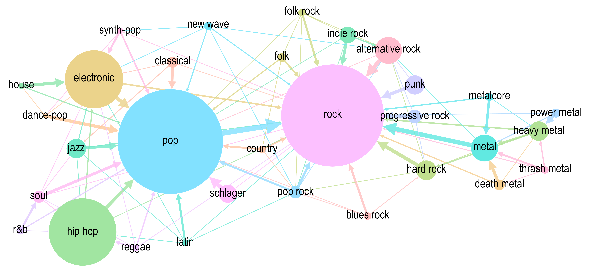

# <b>SHAMPOO</b>: <b>S</b>calable <b>H</b>ierarchical <b>A</b>ssignment of <b>M</b>usic Genres for <b>PO</b>pular music <b>O</b>bjects

<p align="center">
  
  <br/>
  
</p>

<!-- badges: start -->
<p align="center">
  
  
  
  
  
  
</p>
<!-- badges: end -->

## Paper

>[!NOTE]
> Paper details will be added upon publication.

### Abstract
Despite playlists’ popularity on streaming platforms, popular music genres remain a primary orientation scheme among listeners, industry, and researchers. Categorical genre assignments underpin foundational empirical musicological research, but ‘correct’ genre labels are often contested, raising concerns about reliability, validity, and comparability of research results. Contrarily, popular music studies have emphasized the listener-dependent and hierarchical nature of genre assignments – they may be considered as implicit majority voting results of a listener community. Adopting this notion, we present a methodology to assign genre categories based on folksonomy genre votes (SHAMPOO) and demonstrate its feasibility when used with MusicBrainz and 170,497 frequently listened tracks in Germany across the past 50 years (POPTRAG). The resulting hierarchical network for popular music in Germany comprises 265 genres that can be rescaled to any desired number of categories by exploiting latent hierarchical relationships in community tags. Subsequentially, we demonstrate reliability and validity of the procedure. Finally, for tracks lacking community votes, we develop machine learning classifiers at multiple granularity levels using freely-available music features and metadata from online databases. Exemplary results indicate our approach can assign an appropriate genre category to virtually any popular music track, representing listeners’ perspective in a transparent, reproducible, and intersubjectively comprehensible way. 

## Repository layout
This repo primarily contains both, an R package containing SHAMPOO algorithm functions and an analysis pipeline for an exemplary analysis of a corpus of popular music that was frequently listend to in Germany of the past 50 years (POPTRAG).

### R package
The `R` folder contains all functions from the R package. The folder `man` and `test` contain standard package documentation and package function tests. In the root folder, the following files belong to the R package: 
- `DESCRIPTION`
- `NAMESPACE`
- `.Rbuildignore`

### Exemplary Analysis of POPTRAG Corpus
Please find the analysis pipeline for reproduction in the corresponding `analysis` folder, organized by research question (RQ):
- `analysis/_prepare_corpora`
- `analysis/RQ1RQ2_German_popular_music_genres.R`
  > RQ1: What are optimal granularities for community-driven genre partitioning of German Popular Music into small, medium and large taxonomies or fuzzy genre class assignment? 
  > RQ2: What can we learn about the field of popular music in Germany in terms of listener discourse on genre relationships by employing the SHAMPOO method? 
- `analysis/RQ3_robustness_varying_prevalences.R`
- `analysis/RQ4_compare_dc_dz.R`
- `analysis/RQ5a_prepare_ML_data_1.R`
- `analysis/RQ5b_prepare_ML_data_2.R`
- `analysis/RQ5c_ML_tune_train_evaluate.R`
- `analysis/helpers/*` (helper functions related to the RQs)
  - `analysis/helpers/RQ5/spotify_shampoo_genres.R` contains the functions to model additional Spotify SHAMPOO genres
  - `analysis/helpers/RQ5/lyrics_analysis` folder contains the functions to perform the MoreThanWords algorithm (Radke & Lepa, 2026), for further details see [this repository](https://github.com/markusradke/MoreThanWords)
>[!NOTE]
> The scripts reference additional folders. These will be created automatically during analysis.

`data-raw` contains data that is necessary for reproduction. Specifically, this repository includes: 
- `musicbrainz_genre_whitelist_20250616.rds`
  
  A snapshot of MusicBrainz' genre whitelist as of June 16, 2025.
- `classification_prep_features.rds`

  Information on the variables from the corpus used for machine learning (RQ5)
>[!IMPORTANT]
> For running the replication you need additional data, please refer to the [Data Availability Section](#data-availability) below.

>[!NOTE]
> A link to the paper describing the analysis will be added upon publication.

## Data Availability

The data necessary to reproduce the analysis are available in the DepositOnce repository, https://doi.org/10.14279/depositonce-26469. Respecting copyright restrictions, the publicly available version of the POPTRAG corpus does not contain the full lyrics for the songs included in the data set. However, all lyrics features required for reproduction of results are provided in the repository. Please contact us if you require further assistance. 

For analysis the files need to be placed in the following way: 
- `poptrag.rds` &rarr; `data-raw/poptrag.rds`
- `expressiontypes_train_no_ref_type.csv` &rarr; `data/modeled_features/lyrics/expressiontypes_holdout_no_ref_type.csv`
- `expressiontypes_holdout_no_ref_type.csv` &rarr; `data/modeled_features/lyrics/expressiontypes_holdout_no_ref_type.csv`

>[!NOTE]
> Please create the necessary folders for the `expressiontype` files.

Further details on the POPTRAG corpus can be found in repository on DepositOnce.

## R Package Installation

Please use the following command in R to install the package: 
```
devtools::install_github("markusradke/shampoo")
```

Please refer to the function documentation for details on usage. The functions are supposed to be used in the following order: 
1. `get_normalized_wide_vote_matrix()` 
2. `get_tag_dag_from_normalized_votes()`
3. `get_genre_categories_from_graph()`
4. `get_track_category_probabilities()`
5. `add_track_map_to_long()`

Please make sure you start from long tabular data with columns: `id` (unique track identifier), `tag_name` (name of a genre tag) and `tag_count` (number of votes for this tag on the track; if unknown, we suggest setting this to 1). This should be loaded into a `data.table` using the function `fread` from the package with the same name.

## Environment Setup Replication of Analysis
>[!IMPORTANT]
> You do not need to install the R package in order to run the replication.

Please navigate to your desired working directory and clone this repository using: 
```
git clone https://github.com/markusradke/shampoo.git
```

Please make sure you have the following R packages installed when running the scripts: 
- data.table
- DescTools
- dplyr
- flextable
- forcats
- ggplot2
- igraph
- lightgbm
- Matrix
- readr
- reticulate
- rsample
- see
- stats
- stringr
- tidyr
- utils
- yardstick

The following packages would only be required if you were to reproduce the calculation of the lyrics' formulaic expression type featuers, which are readily provided in the DepositOnce repository (see [Data Availability](#data-availability) for details): 
- fastText
- purrr
- stm


Also, for running an Optuna tuning of machine learning models (RQ5), you will need to have a virtual Python environment with the name `.venv` set up in the root folder of the working directory. Assuming, you have the `venv` Python module and Python itself installed on your machine, you can navigate to the root of the working directory and run: 
```
python -m venv .venv # Windows
python3 -m venv .venv # Unix
```
After that please install all the necessary packages contained in `requirements.txt`: 
```
pip install -r requirements.txt
```
In the `analysis/RQ5c_ML_tune_train_evaluate.R` script, please choose to comment out line 8 or 9 according to your operating system.

Finally, please copy the necessary data from the DepositOnce repository to the repective folders (see [Data Availability](#data-availability) for details).

## How to Run the Replication
The analysis scripts are intended to be run after another in the following order:
- `analysis/_prepare_corpora`
- `analysis/RQ1RQ2_German_popular_music_genres.R`
- `analysis/RQ3_robustness_varying_prevalences.R`
- `analysis/RQ4_compare_dc_dz.R`
- `analysis/RQ5a_prepare_ML_data_1.R`
- `analysis/RQ5b_prepare_ML_data_2.R`
- `analysis/RQ5c_ML_tune_train_evaluate.R`

Pre-processed data will be created inside a `data` folder. Models and information on the modeling process will be created inside a `models` folder. Figures will be created inside teh `reports/figures` folder.

## Licensing
Code is licensed under **CC BY 4.0**.

## Contact the author
Markus Radke

[markus.radke@tu-berlin.de](mailto::markus.radke@tu-berlin.de)